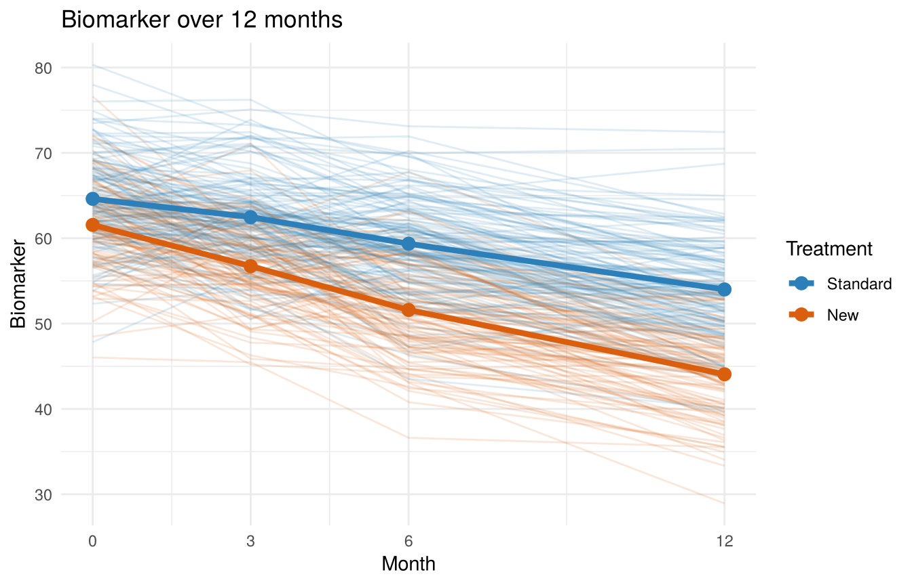
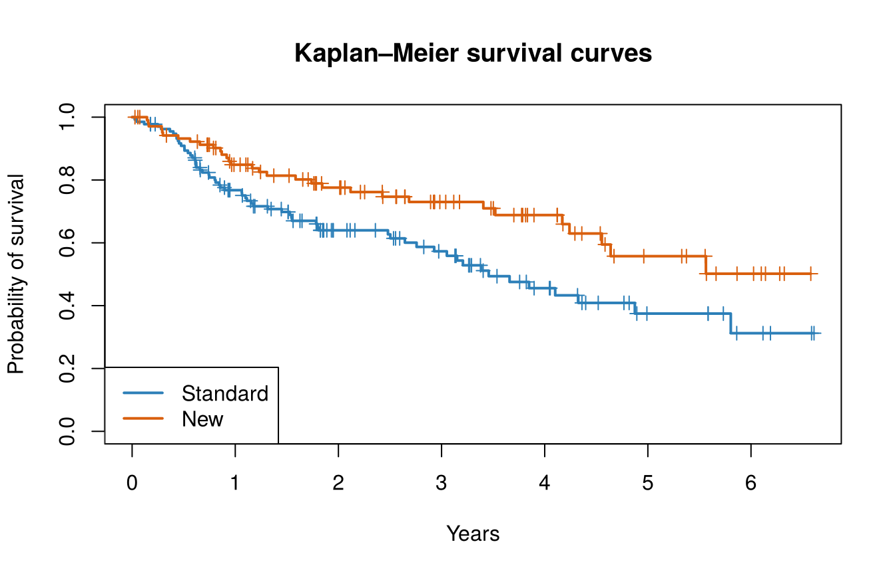

# Longitudinal and Survival Analysis of a Simulated Clinical Study

**Tanvir Ahmed** · R · linear mixed model · Kaplan–Meier · log-rank test · Cox regression

### 📄 [Read the full report →](https://taanvir-ahmed.github.io/longitudinal-survival-analysis/)

This was my final project for a university course in *Longitudinal and Survival
Data Analysis*. It uses a simulated dataset of 240 patients who received either
a standard or a new treatment. A biomarker was measured four times over
12 months, and the patients were then followed for up to seven years.

## Questions

1. Does the biomarker change over time, and does the change differ between the two treatments?
2. Do patients on the new treatment live longer?

## Methods

| Question | Method |
|---|---|
| Biomarker over time | Linear mixed model with a random intercept for each patient (`lme4`) |
| Survival | Kaplan–Meier curves, log-rank test, Cox proportional hazards model (`survival`) |

## Main results

- **Biomarker:** it decreases by about 0.90 units per month with the standard treatment, and about **0.56 units per month faster** with the new treatment (p < 0.001).
- **Survival:** 3-year survival is **73%** with the new treatment and **57%** with the standard treatment (log-rank p = 0.009).
- **Cox model:** adjusted for age and sex, the new treatment lowers the risk of death by about **44%** (HR 0.56, 95% CI 0.36–0.87).





## Files

```
├── analysis.Rmd        # the analysis: code, results and explanations
├── analysis.R          # the same code as a plain R script
├── docs/index.html     # the finished report (shown on the website)
├── data/extra_data.txt # the simulated dataset
├── figures/            # plots made by the analysis
└── renv.lock           # package versions used
```

## How to run it

Open `longitudinal-survival-analysis.Rproj` in RStudio and run:

```r
install.packages(c("tidyverse", "lme4", "lmerTest", "survival", "rmarkdown"))
rmarkdown::render("analysis.Rmd", output_file = "docs/index.html")
```

## Data

The dataset is **simulated** and contains no real patient information. It was
provided by the course instructor and is shared with their permission.

Variables: `id`, `treatment` (0 = standard, 1 = new), `age`, `sex` (0 = female, 1 = male),
`bio_0`, `bio_3`, `bio_6`, `bio_12` (biomarker at month 0, 3, 6, 12), `follow`
(follow-up time in years) and `death` (1 = died, 0 = censored).

## License

Code is released under the MIT License (see [`LICENSE`](LICENSE)).
